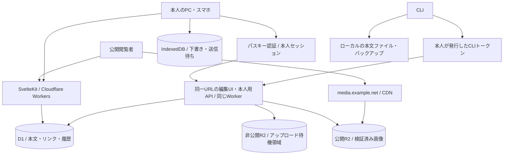

# 個人用公開Wiki・デイリー：設計と段階的実装計画

> **リポジトリでの決定事項（2026-10-15 追記）**
> - ドメインは `infixer.link`（apex）。本文中の `example.net` → `infixer.link`、`media.example.net` → `media.infixer.link`、staging は `staging.infixer.link`（[ADR 0004](adr/0004-domain-infixer-link.md)）。
> - 名称は「Personal Garden」をやめ **infixer.link** に統一（[ADR 0005](adr/0005-naming.md)）。本文中の `garden-text-v1` 等は置換済み。
> - JSON API は **Hono** で実装する（同一 Worker 内。[ADR 0006](adr/0006-hono-api.md)）。§1.2・§2 の「API フレームワークを重ねない」はこれで置き換え。
> - Phase 0 の実証結果と設計への影響は [`implementation-status.md`](implementation-status.md) と [`adr/`](adr/) を参照。
> - 以下は受領した設計本文（「次のプロンプト例」のみ省略、他は変更なし）。

- 作成日：2026-10-15（Asia/Tokyo）
- 更新：同一ページURLでの閲覧・編集、本人限定パスキー認証へ変更。
- 状態：実装前の設計。性能値は目標であり、実測値ではない。
- 仮称：Personal Garden。ドメイン・プロダクト名は未決定。
- 対象：自分だけが編集し、誰でも読める、PC・スマホ両対応の日記とWiki。
- この文書を次の実装プロンプトの入力にする。各Phaseを一度に一つずつ実装する。

## 1. 決定事項と優先順位

### 1.1 ユーザー要件

1. 最優先は「すぐ書ける」「入力が滑らか」「ページが速く表示される」。
2. 全ページは公開。編集・削除・アップロード・履歴閲覧は本人だけ。
3. PCが閉じていても、スマホで編集・公開できる。
4. CosenseのデイリーとWikiに近い使い勝手。リンク補完・関連ページ・画像貼り付けを重視する。
5. CLIからも検索、取得、作成、追記、更新、エクスポートできる。
6. フロントエンドはSvelteKit、TypeScript、生のCSS。日付処理はTemporal。
7. インフラは本人のCloudflareアカウントで管理する。
8. テストを書く。特に保存、競合、認証、日本語入力、復元を検証する。
9. 現行Cosenseは2,000ページ以上、Gyazoは約1,500画像。移行は後から一括でもよい。
10. 将来infixer.netと統合できるよう、保存データをドメインに依存させない。

### 1.2 採用する方針

- **クラウドのD1を本文の正本、R2を画像の正本にする。** ローカルファイルは持ち出し・同期用。
- **アプリとAPIはSvelteKit＋TypeScriptの単一Workerから始める。** APIフレームワークを重ねない。
- **画像は別サブドメイン＋R2で配信する。** 常駐する画像用VMは不要。
- **閲覧・編集・削除は同じページURL上で行う。** 本人セッション確認後に編集機能を遅延読み込みする。一般閲覧者にログイン導線・認証プロンプト・エディタを表示しない。
- **本人の事前登録済みパスキーだけでログインする。** 公開ユーザー登録は設けない。Cloudflare Accessをアプリの本人認証には使用しない。
- **本文は独自仕様を明記したCosense風プレーンテキストを採用する。** 全Cosense記法との完全互換は約束しない。Markdownへの一括変換を前提にしない。
- **オフラインは下書き・直近ページ・作成済みページの編集を支援する。** 全ページ・全画像の常時端末同期はしない。
- **一人用でも版管理による競合検出を行う。** CRDT・共同編集・WebSocketは初期採用しない。
- **CLIの直接API操作を先に、ローカルファイル双方向同期を後に実装する。**

### 1.3 完成の範囲

Phase 0〜8を「日常利用できるv1」とする。Phase 9のローカルファイル同期、Phase 10の既存データ移行までを今回の完成計画に含める。初回実装で全Phaseを実施しない。

以下は別途要件追加が必要：複数編集者、リアルタイム共同編集、非公開ページ、有料記事、任意HTML・UserScript実行、Cosenseの全機能完全互換、infixer.netとの実統合。

## 2. バックエンドの選定

| 候補 | 今回の適性 | 判断 |
|---|---|---|
| TypeScript／Workers | SvelteKitと型・パーサー・Temporalの処理を共有できる。D1・R2へ直接接続。I/O主体のアプリに適する | 採用 |
| Rust／Workers（Wasm） | 重い計算や専用パーサーでは候補。JSとの境界、ビルド、フロントとの仕様共有が増える | 計測でCPU処理がボトルネックになったときのみ再検討 |
| Python／Workers | 実装可能だが、今回フロントとコードを共有できる利点が小さい | 不採用 |
| Go等／Wasm | Workers対応の確認や実行環境との接続が必要。今回の規模では構成追加を正当化しにくい | 不採用 |
| 別クラウドの常駐サーバー | 選択肢は広いが、Cloudflare内で完結する要件から外れる | 不採用 |

TypeScriptが常に最速という判断ではない。今回の主な処理は、短い本文の解析、DB照会、保存、HTML生成。DB往復回数、索引、画像サイズ、配信するJS量を先に最適化する。言語変更は計測後の選択肢。

D1はPrepared Statements＋SQL migrationsを直接使う。初期版ではORM、別Hono API、Redis、KV、Durable Objects、Queuesを加えない。必要性が実測で分かった時点でADRに理由を記録する。

## 3. 全体構成



### 3.1 ドメインと境界

| URL例 | 内容 | 認証 |
|---|---|---|
| `https://example.net/` | 更新順ページ一覧 | 不要 |
| `/p/{pageId}/{任意のtitleSlug}` | 公開ページ。IDが識別子、slugは表示用 | 不要 |
| `/daily/2026-10-15` | 日付から該当ページへ解決。なければ閲覧用の未作成表示 | 不要 |
| `/search?q=...` | 公開検索 | 不要 |
| 同じ`/p/{pageId}/{titleSlug}` | 本人はその場で編集・削除・履歴表示。編集でURLを変更しない | 操作時に本人セッション必須 |
| `/today` | 今日の日付ページを解決。GETでは作成しない | 閲覧不要、作成は本人のみ |
| `/owner/login` | 本人がブックマーク等から開くパスキー入口。公開ナビには載せない | 登録済みパスキーのみ |
| `/owner/settings` | パスキー・セッション・CLIトークン管理 | 本人＋重要操作は再認証 |
| `/api/auth/v1/*` | パスキーchallenge発行・検証・セッション確認 | 各ceremonyの検証 |
| `/api/public/v1/*` | 閲覧用API | 不要 |
| `/api/owner/v1/*` | 更新・履歴・同期・アップロードAPI | 本人のみ |
| `https://media.example.net/*` | 公開済み画像 | 不要 |

`example.net`はプレースホルダーであり、取得済みと扱わない。R2の待機領域とバックアップ領域は公開ドメインに接続しない。

### 3.2 インフラ資源

- SvelteKit Worker＋Static Assets、D1 database。
- R2：公開画像bucket、非公開pending bucket、非公開backup bucket。dev/staging/prodは分離。
- WebAuthn：Workerでパスキー検証、D1で本人・公開鍵・challenge・sessionを管理。Cloudflare Accessのパス保護には依存しない。
- DNS＋TLS：本体とmediaサブドメイン。
- 画像の表示用変換：Cloudflare Images Transformationsを必要なPhaseで有効化。保存先は引き続きR2。料金・利用条件は有効化時に確認。
- 定期バックアップ用Worker／CronはPhase 8で追加。本文のリクエスト処理から切り離す。

## 4. フロントエンドと編集体験

### 4.1 基本画面

- 一覧：更新順、カード／コンパクト表示、カーソルページング。初回30件。
- ページ：タイトル、本文、画像、リンク先・バックリンク、共通リンク先ごとの関連ページ。
- 編集：公開ページ上で本人だけ本文をクリック／タップして編集。タイトル＋本文＋保存状態。編集開始・終了・保存・削除確認でpathname／query／hashを変更しない。削除確定後は同じURLに削除済み状態を表示し、一覧へは任意に戻れる。
- 今日：`/today`。ホーム画面から日付ページへ移動し、ログイン済み本人はその場で書く。未作成の日記は本人の作成操作でPOSTし、確定したページURLへ移動する。GET・閲覧だけで空ページを作らない。
- 検索：タイトル候補を優先。日本語部分一致、本文の抜粋、キーボード操作。
- 履歴：版の比較、復元。復元は新しい版を作る。

### 4.2 エディタ

**CodeMirror 6を本人セッション確認後、同じページ内で遅延読み込みする。** 選択範囲、Undo、長い本文、補完、表示範囲の管理を任せる。自作contenteditableでIMEやUndoを再実装しない。

- Phase 2では基本のテキスト編集で保存を完成させる。
- Phase 3で構文装飾、Wikiリンク補完、インデント操作、非編集中行の装飾・画像表示を加える。
- 編集中の行の元テキストは読める状態にする。文字を隠して選択位置が壊れる装飾は避ける。
- 初期は完全なCosense風ライブプレビューを必須にしない。ただし別画面への頻繁な切り替えを避ける。
- IME composition中に補完確定、装飾による選択移動、自動整形を実行しない。
- 入力で全ページ解析・関連ページ問い合わせを同期実行しない。変更範囲を更新し、重い処理は入力の合間に行う。
- Undo/Redoはページ滞在中の編集履歴。サーバー履歴とは別。
- モバイル：`100dvh`、safe-area、十分なタップ領域、キーボード表示時のスクロールを確認。ピンチズームを禁止しない。
- フォントはシステムフォント。Webフォントを初期ロードしない。
- CSSはSvelteのscoped CSS＋共通カスタムプロパティ。Tailwind／UIキット不使用。

### 4.3 自動保存の状態機械

`clean → dirty → local-saved → sending → synced`

例外：`offline`、`auth-required`、`conflict`、`quota-error`、`server-error`。

- 入力を即時表示。端末内保存は150〜250msのdebounceを初期値とし、実測で調整。
- サーバー保存は入力停止後800ms、連続入力時は最大5秒間隔を初期値とする。
- ページごとの送信は一つだけin-flight。送信中の追加編集は次のスナップショットへまとめる。
- IndexedDB commit完了後だけ「端末に保存済み」、API成功後だけ「公開反映済み」を表示。
- `visibilitychange`でローカル保存を試みる。ページ終了時のネットワーク送信成功を保証しない。
- `beforeunload`は主たる保存手段にしない。突然のOS終了直前の未commit入力までは保証できない。
- 401/403で本文を消さない。下書きを保存してから再ログインへ誘導する。
- 競合時は自動上書きを停止し、手元／サーバー／共通の元版を比較する。
- 本文が大きすぎる場合もローカル下書きは保持する。

### 4.4 オフライン・PWA

- Service Workerは静的アプリシェルと必要最小限の公開読み取りをキャッシュ。
- 本人用API、認証レスポンス、リダイレクト、更新リクエストをCache APIに保存しない。
- 下書き・未送信画像・outboxはIndexedDB。ネット復帰・画面復帰・手動再送で同期する。
- Background Syncには依存しない。iOS等でバックグラウンド実行がなくても、開き直せば再開できる設計。
- キャッシュ済みページと新規日記がオフライン対象。未取得の過去ページは取得できない旨を表示。
- ストレージ残量不足・evictionがあり得る。保存エラーを隠さず、下書きダウンロードを提供する。
- Service Worker更新で編集中に強制リロードしない。
- ログアウト時に、未送信データを保持するかエクスポートして削除するか選べるようにする。

## 5. Temporalと日付

- `src/lib/time/`または共有packageにTemporalアクセスを集約。
- ネイティブTemporalを利用できる場合はそれを使い、非対応環境では`@js-temporal/polyfill`を必要な画面で読み込む。採用時のAPI互換性を確認し、ネイティブ／polyfill双方をテストする。
- 公開閲覧の日時ラベルは原則SSR生成。Temporal polyfillを公開画面へ一律配信しない。
- 日記の日付：`Temporal.PlainDate`、DBでは`YYYY-MM-DD`。
- 基準タイムゾーン：設定値`Asia/Tokyo`。端末のタイムゾーンから暗黙に変更しない。
- 現在の日付：`Temporal.Now.zonedDateTimeISO(timeZone).toPlainDate()`。
- 更新時刻：サーバーが発行するUTC時刻。DBではepoch millisecondsのINTEGER、APIではISO 8601文字列。
- 同期順序・競合判定に端末時計を使わない。整数revisionとchange sequenceを使う。
- 深夜をまたいでも、書いているページを自動で翌日ページへ移動しない。「今日」を再度開いた時点で日付を解決する。
- 前日／翌日はPlainDateの加減算。24時間のミリ秒加減算で代用しない。
- 将来タイムゾーンを変えても、既存の日記の日付は変えない。

## 6. 本文フォーマットと互換性

### 6.1 v1のテキスト形式

`format = link-text-v1`、UTF-8、LF。タイトルは本文と別フィールド。

```text
今日読んだもの
 [アンチ・オイディプス] の続きを読んだ
 #読書
 [https://example.org 参考資料]
 [asset:550e8400-e29b-41d4-a716-446655440000]
```

- 行頭スペースでインデント。タブ入力は仕様化した数のスペースへ変換。
- `[ページ名]`：内部リンク。未作成のページ名も保持。
- `#タグ`：同じ名前のページへの関係として解釈。コード内・URL内は解析対象外。
- `[URL ラベル]`とURL直書き：外部リンク。許可するプロトコルを限定。
- `[asset:UUID]`：R2画像への論理参照。本文に本番ホスト名を書かない。
- 文字装飾、コード、表、数式、アイコンはgrammarとfixtureを追加しながら対応する。
- パーサーは共有の純粋関数：`parse(source, formatVersion)`。行位置、plain text、links、assets、render nodesを返す。
- 任意HTMLは実行しない。テキストをescapeし、許可したnodeだけSSR／Svelteで描画する。
- 無制限な再帰・巨大な正規表現のバックトラッキングを避ける。入力サイズ・リンク数を制限。

### 6.2 Cosense互換マトリクス

| 項目 | 実装段階 | 完了基準 |
|---|---|---|
| 日付ページ・自動保存 | Phase 2 | PC・スマホ・通信復帰で失われない |
| 行インデント・リンク・タグ・補完 | Phase 3 | 日本語と未作成リンクを含むfixture一致 |
| バックリンク・共通リンク先の関連ページ | Phase 3 | 意図したグラフ関係をテスト |
| 画像貼り付け・写真選択 | Phase 4 | 中断・再送・重複を検証 |
| 日本語検索 | Phase 5 | 1〜2文字、長文、英数混在の結果を確認 |
| コード・装飾・表・数式・アイコン・埋め込み | Phase 10までに実データを棚卸し | 対応／未対応／変換方法を全件報告 |
| 任意スクリプト・共同編集 | v1対象外 | 暗黙に互換と扱わない |

「Cosenseでできること」を無制限な完成条件にしない。移行前に実データで利用記法を調べ、日常利用に必要な不足は対応する。未知記法は消さず原文表示する。

## 7. データモデル

### 7.1 基本テーブル

| テーブル | 主な列・制約 | 用途 |
|---|---|---|
| `pages` | `id TEXT PK`, `title`, `title_key`, `source`, `format`, `revision INTEGER`, `daily_date NULL`, `created_at`, `updated_at`, `deleted_at NULL`, `last_mutation_id`, `request_hash`, `last_operation`, `links_json`, `assets_json` | 現在版 |
| `page_names` | `name_key PK`, `page_id FK`, `display_name`, `kind (canonical/alias)` | 現タイトルと旧タイトルの解決・名前の予約 |
| `page_revisions` | `(page_id, revision) PK`, `mutation_id UNIQUE`, `request_hash`, `source`, `title`, `format`, `deleted_at`, `created_at`, `operation` | 全文スナップショット・再送の重複排除 |
| `page_links` | `(source_page_id, target_name_key) PK`, `target_display_name` | 未作成先も含むリンク |
| `page_assets` | `(page_id, asset_id) PK` | 画像参照・未使用判定 |
| `assets` | `id PK`, `sha256`, `object_key UNIQUE`, `mime`, `bytes`, `width`, `height`, `status`, `created_at`, `published_at` | 画像の状態 |
| `upload_intents` | `id PK`, `asset_id`, `pending_key`, `expected_bytes`, `status`, `expires_at` | 期限付きアップロード許可 |
| `changes` | `seq INTEGER PK AUTOINCREMENT`, `page_id`, `revision`, `operation` | CLIの増分取得、削除通知 |
| `settings` | `key PK`, `value` | タイムゾーン・サイト表示名・schema version |

- UUIDを不変IDとして使用。タイトル、日付、URLはIDの代用にしない。
- `title_key`はNFC正規化＋前後空白除去。英字の大小は区別。過度なNFKC変換はしない。
- 名前の重複は409。別名も予約する。削除したページの名前は復元用に保持し、再利用は明示的な操作にする。
- `daily_date`は日記ページのみ。非NULL値にUNIQUE制約を付ける。
- タイトル変更時は旧名をaliasとして保持。本文全件を自動書き換えしない。
- 参照は名前から`page_names`を通じてIDへ解決。未作成先は名前のまま残る。
- 削除はsoft delete。公開読取・検索・関連ページから除外する。画像を連動して即時削除しない。
- `page_revisions`は自動保存単位の復旧用。UIでは同じ編集セッションをまとめて表示できる。初期は自動間引きを行わず、容量増加を監視して保持方針を後から決める。

### 7.2 索引

- `pages(updated_at DESC, id)`：一覧のカーソルページング。削除済み除外を考慮。
- `page_names(page_id)`、`page_links(target_name_key, source_page_id)`：名前解決とバックリンク。
- `page_assets(asset_id, page_id)`、`page_revisions(page_id, revision DESC)`。
- `assets(status, created_at)`、`changes(seq)`。
- 外部キー・UNIQUE・CHECKはmigrationで明示し、D1実行環境で検証する。

### 7.3 保存の原子性と競合

APIに`baseRevision`とUUIDの`mutationId`を必須とする。更新の核は条件付きの一つのUPDATE。

```sql
UPDATE pages
SET source = ?, title = ?, revision = revision + 1,
    last_mutation_id = ?, request_hash = ?, last_operation = ?,
    updated_at = ?, links_json = ?, assets_json = ?
WHERE id = ? AND revision = ? AND deleted_at IS NULL;
```

- `request_hash`はoperation・page ID・baseRevision・更新payloadを正規化してサーバーで計算する。triggerはこの値を履歴へ複写する。
- 同じ版に対する二つの更新は片方だけ成功。0行更新なら404または409を判定。
- `pages`のINSERT／UPDATEを起点とするDB triggerで、履歴、変更sequence、名前、リンク、画像参照、検索索引を同じSQL操作の原子的な範囲で更新する設計を第一候補にする。
- パーサーが作ったリンク・画像参照のJSONをSQLへ渡し、triggerで`json_each`を使って反映する。クライアントから渡された解析結果は信用せずサーバーで生成する。
- triggerには変更のないリンク集合を再挿入しない条件を設け、毎キー入力の全リンク書き換えを避ける。
- 制約違反なら本文を含めてロールバック。旧名aliasと新名の衝突も同様。
- **Phase 1でD1上のtrigger・JSON・検索索引の整合性を実証する。** 不適合なら条件付きbatchへ変更するが、更新0行をSQLエラーと誤認しない。無条件で履歴やリンクを更新するbatchは禁止。
- `D1.batch()`のロールバックはSQL失敗時に働く。条件付きUPDATEが0行でも自動で失敗にはならない。
- 同じ`mutationId`の再送は履歴から元の成功結果を返す。内容のhashが異なれば409。同時再送もUNIQUE制約後に再照会して扱う。
- 作成、改名、削除、復元、CLI追記にも同じ原則を適用する。復元専用UPDATEは削除済みを含めてrevision条件で更新し、通常編集の`deleted_at IS NULL`条件を流用しない。
- API成功結果は更新後の可変pages行ではなく、確定したmutationIdに対応する履歴・changesから構成する。直後の別更新の版を誤って応答しない。
- 初期はD1 read replicationを有効化しない。導入時はSessions／bookmarkでread-after-writeを別途設計する。

## 8. API契約

JSON APIは`/v1`で固定。日時はISO文字列、日付はYYYY-MM-DD、revisionは整数。リストは上限付きカーソル方式。

| Method / path | 用途 |
|---|---|
| `GET /api/public/v1/pages?cursor=&limit=` | 公開一覧、デフォルト30・上限100 |
| `GET /api/public/v1/pages/{id}` | 公開本文・revision・ETag |
| `GET /api/public/v1/resolve?title=` | 名前／alias解決 |
| `GET /api/public/v1/search?q=&cursor=` | タイトル・本文検索 |
| `GET /api/public/v1/pages/{id}/related` | 直接リンク・逆リンク・関連候補 |
| `GET /api/auth/v1/session` | 匿名ならauthenticated:false、本人なら必要最小限の権限・CSRF token。常にno-store |
| `POST /api/auth/v1/authentication/options` | ログインchallenge発行 |
| `POST /api/auth/v1/authentication/verify` | 署名検証、challenge消費、session発行 |
| `POST /api/auth/v1/registration/options`、`verify` | 初回setup許可または本人の直近再認証が必須 |
| `POST /api/auth/v1/logout` | 現session失効 |
| `/api/owner/v1/passkeys`、`sessions`、`tokens` | 登録credential・session・CLI tokenの管理。変更はPOST／DELETE |
| `GET /api/owner/v1/pages/{id}` | キャッシュを通さない最新本文 |
| `POST /api/owner/v1/pages` | 作成。client-generated UUID可 |
| `PUT /api/owner/v1/pages/{id}` | source／title更新、baseRevision必須 |
| `DELETE /api/owner/v1/pages/{id}` | soft delete、baseRevision必須 |
| `POST /api/owner/v1/daily/{date}` | 今日のページを取得または作成。二重作成しない |
| `GET /api/owner/v1/pages/{id}/revisions` | 非公開の履歴取得 |
| `POST /api/owner/v1/pages/{id}/restore` | 過去版を新しいrevisionとして復元 |
| `POST /api/owner/v1/uploads` | 画像アップロードintent発行 |
| `POST /api/owner/v1/uploads/{id}/complete` | 検証・公開確定。冪等 |
| `GET /api/owner/v1/changes?after=&limit=` | CLI増分同期・削除情報 |
| `GET /api/owner/v1/export?...` | 分割エクスポート用データ |

更新の例：

```json
{
  "baseRevision": 12,
  "mutationId": "UUID",
  "title": "2026-10-15",
  "format": "link-text-v1",
  "source": "今日のメモ\n [読書]"
}
```

- 200／201：`pageId`, `revision`, `updatedAt`, `changeSeq`, `mutationId`。
- 409：`code: revision_conflict`、現在のrevisionと最新取得先。自動上書きしない。
- 400、401、403、404、413、415、422、429、503を用途に応じて使い分ける。
- エラーは`code`, `message`, `requestId`, `retryable`を返す。内部SQLや秘密情報を返さない。
- 初期上限：本文256KiB UTF-8、タイトル200 Unicode code points、抽出リンク1,000／ページ、画像参照200／ページ、検索語200文字。実データで再評価する。
- SQLは全てbind。任意SQLやR2 keyを受け付けない。
- API契約からCLIとWebで型を共有し、runtime validationも行う。

## 9. 同じURLでの本人限定パスキー認証

### 9.1 画面と権限の分離

- 公開ページは常に通常の本文としてSSRし、一般閲覧者へログインリンク・登録フォーム・編集ボタンを出さない。
- ページ起動後に小さな`/api/auth/v1/session`照会を一度だけ行う。本文描画を待たせない。匿名には個人情報を返さない。
- 本人なら同じDOM上に編集操作を追加し、CodeMirrorを遅延ロードする。編集用URLへ遷移しない。
- 一般閲覧者にはパスキーの自動promptもconditional autofillも起動しない。
- 本人はブックマークした`/owner/login`から明示的にログインし、同一origin内の元ページへ戻る。通常ナビ・sitemapにこの入口を載せない。returnToは同一originの許可パスに限定する。
- 入口URLやAPIの存在は秘密・防御手段と考えない。URLを知る人がいても、登録済みcredentialの検証に成功しなければログインできない。
- 更新・削除・画像uploadは全てサーバーで本人sessionを検証する。ボタン非表示だけで認可したことにしない。

### 9.2 初回の所有者登録（bootstrap）

最初のパスキー登録と、以後のパスキー認証は別の操作。公開された登録画面で「最初に来た人をownerにする」設計は禁止。

1. 運用者がCloudflareの管理権限を使うsetup CLIで、単一owner行と256-bit以上の一時setup tokenを作る。DBにはhash・有効期限（初期10分）・未使用状態を記録する。
2. 本人がHTTPSのsetup画面へtokenを手入力／貼り付けし、短命のsetup sessionに交換する。tokenをURL query・アクセスログへ出さない。
3. setup sessionに紐づくWebAuthn登録challengeを発行し、端末のパスキーを登録する。
4. 初回credential INSERT、challenge消費、setup完了を原子的に確定する。setupが既に完了なら拒否する。二つの並行登録が両方成功しない制約を設ける。
5. setup許可を失効し、通常の公開登録を閉じる。期限切れ・中断時は管理CLIから新しいsetup許可を発行する。

ownerは一人。メールアドレスの自己申告やメールの一致で新規ownerを作らない。setup画面を開いただけでは登録できない。

### 9.3 WebAuthn検証

- `@simplewebauthn/server`をserver-onlyで使う。browser側は`@simplewebauthn/browser`をログイン・credential管理操作時だけ読み込む。
- Phase 0で対象Workers runtime、Web Crypto、packageの互換性を実証し、必要なcompatibility flagを記録する。動くと推測したまま本番採用しない。
- RP IDは確定した本体host（例`example.net`）、expectedOriginは`https://example.net`に固定する。Host headerから動的生成しない。stagingは別RP ID・origin・DB。
- challengeは暗号学的乱数、短命（初期5分）、一度だけ使用可能。登録／認証のpurpose、開始browserの短命HttpOnly cookie、ownerに紐づける。
- ログインにはdiscoverable credentialを使い、公開optionsで本人の全credential IDを列挙しない。返されたcredential IDとuserHandleが登録済みの単一ownerに属することを確認する。
- challenge、origin、RP ID hash、署名、user presence、user verificationを検証する。`userVerification: required`、サーバーでも`requireUserVerification: true`。
- 登録時は公開鍵、credential ID、userHandle、counter、transports、backup flags、作成日時、名前を保存。秘密鍵・指紋・顔情報は受け取らない。
- 同期パスキーではcounterが0等の場合がある。単純な「毎回増加必須」の独自判定を作らず、ライブラリの検証とcredential特性に従う。
- 検証後にchallengeを条件付きで消費し、その成功に紐づいてsessionを作る。並行再送で複数sessionが発行されないトランザクションをテストする。
- options／verifyはno-store、Origin検証、IP・challenge単位のレート制限を行う。owner全体を簡単にロックして第三者が本人を締め出せる方式は避ける。

### 9.4 セッションと再認証

- ランダムな256-bit以上のopaque session tokenを発行。DBにはhashのみ保存。
- cookie：`__Host-link_session`、Secure、HttpOnly、SameSite=Lax、Path=/、Domainなし。localStorageへtokenを保存しない。
- 初期期限はidle 7日／absolute 30日を候補とし設定可能にする。DB書き込み削減のためlastSeen更新を間引くが、失効・期限確認は本人APIごとに行う。
- 初回ログイン後はsessionで編集できる。通常保存のたびにFace ID等を要求しない。別browser、期限切れ、失効後は再認証。
- credential追加・削除、CLI token発行、全session失効等は直近5分以内のパスキー再認証を必須とする。
- browser更新はOrigin検証＋sessionに紐づくCSRF token。GETでデータ変更しない。session失効時はJSON 401を返し、下書きを保持して明示的な再ログインに進む。
- 端末一覧からsessionを個別失効できる。ログアウトはDB失効＋cookie削除。
- 全ページの保存済み本文は公開。端末内下書き、履歴、credential情報、待機画像、backupは非公開。

### 9.5 追加パスキー・紛失・domain変更

- 本人の再認証済みsessionだけ追加登録可能。新規ユーザー登録は設けない。
- PC／スマホは同期パスキー、対応するcross-device認証、または本人が追加した別パスキーを利用できる。異なるOS間の同期を自動で保証しない。
- 復旧のため予備のパスキー／セキュリティキーを追加できるようにする。最後の有効credentialの削除は通常UIでは拒否。
- 全パスキー紛失時は、Cloudflare管理権限で短命のrecovery許可を生成するrunbookを用意する。一般公開のメールresetは作らない。
- recovery完了時は旧credential、session、CLI tokenを失効し、新credentialへ置き換える。公開本文は削除しない。通常のsetupを公開し直さない。
- パスキーはRP IDに紐づく。将来infixer.netへdomainを変更すると、本文が可搬でもパスキーはそのまま移せるとは限らない。旧originで本人認証できる間に新originの登録を行う移行手順を設計する。

### 9.6 CLI

- Webでパスキー再認証後、本人だけが専用API tokenを発行できる。tokenは一度だけ表示し、DBにはhash、期限、scope、失効状態を保存。
- 初期scopeはread／write／backup。credential管理・CLI token追加はCLI tokenに許可しない。
- CLIはBearer tokenで認証。環境変数またはOS credential storeに置き、ソース、本文、Git、browser bundleへ入れない。
- cookie非使用のBearer経路はCSRF対象外。ただしOrigin不在だけで認証を省略しない。cookieとBearerの曖昧な混在は拒否。
- 期限・失効をAPIごとに検証。CLIで直接WebAuthnを実装することは初期要件にしない。

### 9.7 必要な認証テーブル

| テーブル | 主な列・制約 |
|---|---|
| `owner` | singleton PK（固定値1）、WebAuthn userHandle UNIQUE、setup状態 |
| `passkeys` | credentialId UNIQUE、owner FK、publicKey、counter、transports、backup flags、revokedAt |
| `auth_challenges` | id、challenge、browserBindingHash、purpose、expiresAt、consumedAt、owner FK |
| `sessions` | tokenHash UNIQUE、owner FK、credentialId、createdAt、lastSeenAt、idleExpiresAt、absoluteExpiresAt、reauthenticatedAt、revokedAt |
| `setup_grants` | tokenHash UNIQUE、purpose（setup/recovery）、expiresAt、consumedAt |
| `api_tokens` | tokenHash UNIQUE、owner FK、label、scopes、expiresAt、revokedAt |

認証テーブルは公開DTOや本文exportに含めない。disaster recovery用backupは非公開かつアクセス制限し、復元時にsession／tokenを原則失効する。

### 9.8 配信境界

- `workers.dev`、preview、別hostからでもAPIの認証を省略しない。productionの既定hostは無効化し、WebAuthnは固定originでのみ実施する。
- CSP、nosniff、URL scheme制限。外部埋め込みは許可先のみ。
- owner固有の状態・下書き・認証レスポンスをpublic cacheへ入れない。同一URLでも公開SSRとsession照会は分離する。
- 公開ページ削除後は通常URLで非表示。ただし外部クローラ等のコピーは回収できない。

## 10. 画像：R2と配信の分離

### 10.1 役割

R2は画像ファイルの保管先であり、画像変換サーバーそのものではない。公開R2に`media.example.net`を接続し、CDNキャッシュを設定する。本文APIへ画像の全バイトを毎回通さない。

- 原本：不変key、例`originals/{sha256}.{ext}`。
- 本文：`assetId`で参照し、API／rendererが画像URLを解決。
- 表示：幅320／640／1280／1920等の許可リストから選択。無制限に任意サイズを生成させない。
- Cloudflare Images Transformationsを使う場合は、公開済みR2由来の画像だけを入力にし、利用料金を確認する。ブラウザの対応に合わせたWebP等の出力を利用。
- `width`／`height`を必ず持ち、レイアウトのずれを防ぐ。最初の主要画像以外はlazy-load。
- 初期はJPEG／PNG／WebP／GIF。SVGはアップロード拒否。HEIC等は未対応なら明確に知らせ、後続の変換対応として扱う。iPhoneの写真選択で実際に渡される形式を実機確認する。
- EXIFの扱いを明記。初期は原本にメタデータが残り得るため、アップロード画面に「原本が公開される」ことを表示する。位置情報を除去する設定は対応する画像pipelineを検証してから追加する。

### 10.2 アップロードフロー

1. 画像を選択／貼り付け。object URLで即時preview。可能ならBlobをIndexedDBへ保存。
2. `uploads`へMIME・サイズを送り、期限付きintentと署名付きPUT URLを取得。
3. ブラウザから**非公開pending bucket**へ直接PUT。CORSは本体の許可Originのみ。
4. `complete`でサーバーが実サイズ、ファイルsignature、寸法、許可形式を検証。Content-Type headerだけで判断しない。
5. 合格後に公開bucketへ新しい不変keyとしてコピーし、assetをreadyにする。
6. 本文内の一時画像markerを`[asset:UUID]`に置換して自動保存。
7. readyかつローカル参照置換が完了した画像だけ、ローカルBlobを削除できる。

- 未完了markerを含むスナップショットは公開しない。そのページは「画像の送信待ち」として下書きに保持し、完了後に送信する。文字だけを先に公開したい場合は画像markerを明示的に外して保存できる。
- 初期上限候補：10MiB／画像、40 megapixels。サイズ上限は実機とWorkersの実行制限で検証して調整。
- 署名付きPUTは保存後の検証だけで転送中の大きさを厳密制限できると考えない。期限・intent回数を制限し、上限超過objectは削除して公開しない。
- 公開bucketのkeyへの署名付きPUTは発行しない。署名URLの再利用による公開原本の書き換えを防ぐ。
- 完了処理はasset単位で冪等。DB更新失敗・copy失敗の途中状態から再試行できる。
- 同一hashは重複排除候補。既存画像への権限と整合性を確認して再利用。
- pendingは24時間以上経過したものを定期削除。未参照の公開画像は即削除せず、履歴とバックアップも考慮したGCを後から実装。
- CDNは不変画像に長いTTL。画像の変更は新しいkey。本文のキャッシュ方針とは分ける。

## 11. 検索とリンクグラフ

### 11.1 日本語検索

D1はFTS5に対応するが、デフォルトの分かち方だけで日本語検索の使い勝手が保証されるわけではない。

1. タイトル完全一致、prefix、aliasを優先する。
2. Phase 5でFTS5 trigram tokenizerが対象D1で動くか実証し、3文字以上の部分一致を評価する。
3. 1〜2文字はタイトル・本文の上限付き`LIKE`検索をfallbackとする。`%`／`_`はescapeし、ページング・タイムアウト・query長制限を付ける。
4. trigramが利用不可または性能不足なら、アプリ側のn-gram転置索引を比較して採用する。最初から外部検索サービスは加えない。
5. FTSのquery syntaxをそのまま公開しない。検索語を安全に構成する。
6. 2,000／10,000ページfixtureで検索の正確さ、p95時間、rows read/writeを記録する。

入力は150〜250ms debounce、古いfetchはAbortControllerで破棄し、古い応答で新しい検索結果を上書きしない。補完は本文検索と分離する。

### 11.2 関連ページ

- 直接リンク：自ページから参照する先。
- バックリンク：自ページを参照する元。
- 共通リンク先：自ページと同じ名前／同じ解決先ページを参照する他ページ。リンク先ごとにまとめる。
- 別名はpage IDへ解決して重複を除く。未作成先はname keyでまとめる。
- 全グラフをブラウザへ送らない。1ページの関連候補を上限付きでSQL取得。
- 初期上限：直接リンク50、逆リンク50、共通リンク先5グループ×10件。続きを取得できる。
- 汎用タグに接続が集中しても、無制限に2-hop展開しない。
- 関連ページは本文表示後に取得可能。保存操作を待たせない。

## 12. キャッシュと性能予算

### 12.1 初期方針

- 公開本文はSSR。本文が表示されるためにクライアントJSを必須にしない。
- 同じページURLで本人sessionを確認した後だけCodeMirror、IndexedDB、Temporal fallbackを読み込む。公開SSRに本人用データを埋め込まない。session照会はno-storeで本文表示をブロックしない。
- JS／CSSのhash付きasset、画像は長期cache。
- **v1の可変HTMLと公開本文APIはCDNで長期cacheしない。** 初期は`no-cache`＋revision ETagで再検証、編集・本人用APIは`no-store`。
- 各公開ページはD1の現在revisionを確認し、必要なら`{pageId, revision, rendererVersion}`の不変レンダー結果を内部cacheに保持できる。履歴の公開endpointにはしない。
- Worker Cache APIのdeleteが世界中のcacheを一括削除するとは扱わない。本文HTMLの短期CDN cache導入は、stalenessの許容と全域purgeを別途設計した後。
- 先に実測し、キャッシュの複雑さよりDB往復削減を優先する。
- 一覧はカーソル方式。SELECT対象列を絞り、全本文を付けない。
- 公開ページでは本文・タイトル等をまとめて取得し、不要な直列DB往復を避ける。
- 解析HTMLをDBに保存する場合は再生成可能な派生データとし、sourceを正本とする。

### 12.2 性能目標（初期予算）

| 対象 | 目標 | 測定条件 |
|---|---|---|
| 公開初回JS | gzip 50KiB以下を目標 | production build、初回routeの依存合計。画像除外 |
| 編集初回JS | gzip 250KiB以下を目標 | エディタ・Temporal fallbackを含む。内訳を記録 |
| 公開LCP | p75 2.5秒以内 | モバイル相当4G、cold/warmを別記 |
| CLS | 0.1以下 | 画像を含む日記 |
| 入力から描画 | p95 50ms以内、通常フレーム16ms程度を目標 | 10,000文字ページ、CPU throttleと実機 |
| INP | p75 200ms以内を目標 | 実運用データが集まるまではlabの操作時間で代替 |
| 保存API | p95 800ms以内を初期目標 | 日本からstaging、50回以上、debounceを除外 |
| 検索API | p95 500ms以内 | 2,000／10,000ページ、日本語各種query |
| 関連ページAPI | p95 500ms以内 | 接続集中ページを含む |

目標未達時はbundle、CPU、ネット、D1 rows、画像を分けて原因を記録する。未達を隠すために測定条件や予算だけを変更しない。SvelteKit採用のみで上記性能を保証しない。

## 13. CLI・エクスポート・ファイル同期

### 13.1 CLI v1

Node.jsのサポート中LTS上でTypeScript由来のCLIを実行。標準fetchと必要最小限の引数解析を使う。

```sh
infixer today
infixer get PAGE_ID
infixer append today '読書メモ'
infixer search 'アンチ・オイディプス'
infixer put PAGE_ID --file note.link.txt --base-revision 12
infixer export ./export
infixer backup ./backup --with-assets
```

- `--json`、非対話モード、意味のある終了コードを用意。
- appendもread→baseRevision付きupdate。競合した場合は勝手に再追加せず確認／失敗。通信再送では同じmutationIdを再利用。
- エラー時にアクセストークンや本文をログへ出さない。
- backupは大量データをWorkerの一リクエストでZIP化しない。ページングし、CLI側で保存する。

### 13.2 持ち出し形式

```text
export/
  manifest.json
  pages/{pageId}.link.txt
  metadata/{pageId}.json
  assets/{assetId}.{ext}       # --with-assets時のみ
  assets-manifest.json
```

metadataにはid、title、format、revision、dailyDate、timestamps、aliasesを含める。manifestにはschemaVersion、export時刻、件数、hashを含める。ファイル名にタイトルを使わず、改名・禁則文字・path traversalを避ける。

Markdown変換は別コマンドの派生出力として追加できる。独自記法を無言で失う変換はしない。

### 13.3 双方向ファイル同期（Phase 9）

- `infixer pull`で本文とmetadataを取得し、`.infixer/state`にbaseRevisionとbase内容hashを記録。
- `infixer push`はローカル変更だけ送信。remote変更と同時なら三者比較し、競合ファイルを作る。
- 更新sequenceで削除も取得。ローカルのファイル欠落を自動でサーバー削除と解釈しない。削除は明示コマンド。
- 画像はデフォルトでmanifestのみ。必要時download、`--with-assets`で全件。
- 初期は明示的なpull／push。常駐watchを必須にしない。
- データを変更した後にローカル同期stateを更新する。途中失敗しても同じ処理を再開できる。

## 14. テスト方針

### 14.1 使用ツール

- Vitest：純粋関数、状態機械、パーサー、日時、API契約。
- Cloudflare公式のWorkers向けVitest統合：実行時点の公式推奨packageを確認して固定。D1・R2 bindingの統合テストをworkerdで実行。
- Playwright：PC Chromium／WebKitとモバイルviewportでE2E。実機Safari／Chromeの確認も別途実施。
- Svelte check、TypeScript、formatter/linter。lockfileをcommit。
- 性能：production build解析、Lighthouse CIまたは同等の固定条件測定、Playwright計測、実機のPerformance trace。

### 14.2 必須テスト

| 分野 | ケース |
|---|---|
| 認証 | 未ログイン、未登録credential、誤署名／origin／RP ID、UVなし、challenge再送・期限切れ・並行使用、bootstrap横取り防止、session失効、CSRF、CLI失効token、別host迂回 |
| 同一URL・認証UX | 閲覧→編集→保存→削除確認でURL不変、匿名にログイン導線・promptなし、匿名がowner操作を直接呼ぶと拒否、本人UIがcache経由で他人へ漏れない |
| パスキー管理 | 追加登録に再認証必須、最後のcredential削除拒否、setup許可の一回性、紛失復旧で旧credential/session/token失効 |
| 原子的保存 | 本文成功時に履歴・リンク・索引が一致。制約失敗時に全て旧状態。0行UPDATEで派生データ不変 |
| 競合 | 同一revisionから2更新→成功1・409が1。元版を失わず解決できる |
| 冪等性 | 応答紛失→同mutation再送でrevision・追記が増えない。異内容のID再利用は拒否 |
| 自動保存 | 連打、入力中に保存応答、応答順序、再ログイン、reload、通信断、容量不足 |
| 日付 | JST深夜、うるう日、月末、DST地域への設定変更、端末timezone差、時計ずれ |
| リンク | 日本語、alias、改名、未作成先、削除復元、タグ、コード内の偽リンク |
| 画像 | 中断、完了再送、サイズ偽装、MIME偽装、SVG拒否、公開前アクセス不可、copy後DB失敗、同hash |
| 公開範囲 | 履歴・pending・backupが非公開。削除後の本文が通常URLから取得不可 |
| 検索 | 1／2／3文字、日本語英数混在、特殊文字、更新・削除・復元後の索引一致 |
| CLI | token漏えいなし、ファイル名安全性、エクスポート→復元で本文・画像hash一致 |
| オフライン | キャッシュ済みページ編集、新規日記、画像待機、再接続後の競合、SW更新中の下書き保持 |

### 14.3 手動確認が必要なケース

自動ブラウザのcomposition eventだけで実際のIME動作確認を済ませない。

- macOS日本語IME：変換、確定、再変換、Undo、複数行貼り付け。
- iPhone Safari：キーボード表示、写真選択、ホーム画面起動、アプリ切替後の復帰。
- Android Chrome：日本語入力、戻る操作、ネット切替。
- スクリーンリーダーで入力欄と保存状態の読み上げ。保存通知をキー入力ごとに読み上げない。

端末が利用できなければ「未検証」と明記する。未実施を成功扱いしない。

### 14.4 CI

PR／変更単位：型→unit→Workers統合→主要E2E→build→bundle予算。staging：実機パスキー・R2 CORS・画像変換・実ネット性能。production前：backup／restore、認証迂回、日記の一連の操作。

カバレッジ数値のみを目標にせず、データ消失や公開範囲の誤りを検出するテストを優先する。各Phaseで追加した範囲を検証し、同じチェックの無意味な繰り返しはしない。

## 15. 運用・バックアップ

- dev／staging／prodでD1・R2・RP ID／origin・secretsを分ける。
- stagingは合成データだけを利用し、productionの認証DBや秘密を複製しない。実データが必要なら環境全体の追加アクセス制限を別途設け、アプリのパスキー認証とは分ける。
- secretsはWrangler／Cloudflareのsecret管理へ。`.dev.vars`をGit対象外にする。
- schema migrationは番号付きSQL。破壊的変更前にバックアップ。アプリは可能なら前後schemaに互換を持たせる。
- ログ：requestId、status、duration、query回数、rows read/write、revision、画像処理状態。本文・cookie・署名URL・tokenを記録しない。
- 監視：保存失敗率、409率、5xx、p95、未完了画像、バックアップ最終成功時刻、D1容量、R2容量、変換数。
- 課金項目：Workers request/CPU、D1 storage/rows、R2 storage/operations、Images transformations、ドメイン。無料枠で確実に収まるとは約束しない。
- バックアップはD1の運用上の復旧機能だけに依存しない。日次の本文・metadata・画像manifestを非公開bucketへ保存。
- 一貫したexportは開始時のchanges high-water markを固定し、それ以前の最新revisionから構成する。途中更新でページ集合と本文が食い違わないようにする。
- 画像はhash付きmanifestで検証。削除前に保持期間とbackup参照を確認。
- Cloudflare外へのコピーはCLIでPCまたは外付け媒体へ保存可能にする。同じアカウント内のコピーだけを唯一のbackupにしない。
- 初期目標：日次backupでRPO 24時間、復元手順を半日以内で実行可能。実際のrestore演習時間を記録し、保証値としない。
- restore演習は空のstagingへ行い、件数・本文hash・画像hash・リンク・検索を確認する。

## 16. リポジトリ構成案

```text
apps/
  web/
    src/routes/                # SvelteKit pages, owner/public APIs
    src/lib/components/
    src/lib/editor/
    src/lib/offline/
    src/lib/server/auth/
    src/lib/server/repositories/
    src/lib/server/services/
    src/lib/styles/
    migrations/
    tests/
    wrangler.jsonc
  cli/
packages/
  content/                     # grammar, parser, graph extraction
  contracts/                   # DTO, validation, error codes
  time/                        # Temporal wrappers
  sync/                        # revision, mutation, three-way comparison
ops/
  backup/                      # Phase 8で追加
  runbooks/
docs/
  design.md
  implementation-status.md
  adr/
  compatibility.md
  performance.md
```

- pnpm workspace程度に留め、初期からmonorepo管理フレームワークを入れない。
- browser moduleから`server/`、secret、D1 bindingをimportさせない。
- SvelteKit endpointとCLIで契約を共有し、DBモデルをそのまま公開DTOにしない。
- 新規実装先はユーザーが指定したrepo、またはこのworkspace内の新しい専用directory。既存の`sources/`等の同期資料は変更しない。

### 16.1 ライブラリ方針

| ライブラリ | 用途・導入時期 |
|---|---|
| SvelteKit / Svelte / adapter-cloudflare | 基盤、Phase 0 |
| TypeScript / Wrangler | 型・Cloudflare開発、Phase 0 |
| `@js-temporal/polyfill` | 非対応runtime fallback、Phase 0でbundle検証 |
| CodeMirror 6必要moduleのみ | 編集、Phase 2 |
| `@simplewebauthn/server` / `@simplewebauthn/browser` | WebAuthn検証／認証操作。Phase 0でWorkers互換性を実証、Phase 1で導入。browser packageは認証時のみ |
| Valibot等の小さなschema validator | 契約のruntime検証、Phase 1。実測し一つに統一 |
| `idb` | IndexedDBの薄いwrapper、Phase 2 |
| `aws4fetch`等の署名実装 | R2 presigned PUT、Phase 4。server-only |
| Vitest / Playwright / Workers公式testing統合 | 各段階のテスト |
| 数式・コード強調等 | 実データ上必要になった段階で遅延導入 |

バージョン番号はこの文書で推測固定しない。Phase 0で公式の互換組み合わせを確認し、lockfile・compatibility_dateと採用理由を記録する。用途が同じライブラリを重複導入しない。

## 17. 段階的実装計画

各Phaseで「実装→テスト→手動確認可能な成果物→status更新」を完了する。次のPhaseへ自動で広げない。外部アカウント未設定で止まる場合も、ローカルで検証できる部分と設定手順を完成させ、未検証範囲を具体的に示す。

### Phase 0：基盤と性能・互換性の実証

**目的**：採用stackがCloudflareで動くことを、小さく確認する。

実装：
- 専用repo/directory、SvelteKit＋TypeScript＋生CSS、Cloudflare adapter、D1/R2 local binding。
- hello SSRページ、health endpoint、Temporalで今日を表示。
- unit／Workers統合／Playwrightの最小構成とCI。
- D1のtrigger・JSON・FTS5 trigramの能力確認用テスト。結果をADRに記録。
- SimpleWebAuthnのWorkers実行と署名検証を確認。ローカルWebAuthnとHTTPS stagingの検証方法を用意。
- production bundle計測、README、環境変数template、実装status。

テスト：SSRがJS無効でも表示される、TemporalのJST日付、D1 CRUD、R2 put/get、build成功。

完了条件：localで起動・テスト・buildが再現できる。アカウントがあればstagingへ最小deployし確認。なければ未検証と記録。本文編集はまだ実装しない。

### Phase 1：データと本人認証

依存：0。

実装：schema/migrations、単一owner bootstrap、パスキー登録／認証、opaque session、credential追加・復旧、owner/public境界、ページCRUD、revision、mutationId、soft delete、履歴・リンクの原子性。簡素な読取画面。

テスト：未認証更新拒否、WebAuthn署名・origin・RP ID・challenge検証、bootstrap二重使用拒否、session失効、同時更新、再送、名前衝突、削除復元、trigger失敗時rollback。test専用認証adapterがproductionで有効にならないこと。

完了条件：保存内容と派生データが壊れず、本人以外の更新が拒否される。stagingでパスキー登録→ログイン→再認証を確認し、bootstrap／復旧手順と認証迂回テストを記録。

### Phase 2：日記を毎日書ける最小版

依存：1。

実装：`/today`と公開ページ上の同一URL編集、本人session確認後のCodeMirror遅延ロード、日付ページ、タイトル、800ms自動保存、IndexedDB下書き、保存状態、読み取りページ。最新revision取得。送信はページごとに直列。

テスト：typing→local保存→API反映、保存中の追加入力、reload復元、auth失効、同日二重作成、深夜境界、2端末相当の競合。

完了条件：PCとスマホviewportで一日分を書ける。画像はまだ不要。10,000文字で入力性能を測る。IME実機検証の実施／未実施を明記。

### Phase 3：Cosense風のリンクと操作感

依存：2。

実装：link-text-v1 parser、インデント、リンク／タグ補完、未作成先、alias、関連ページ、行装飾、閲覧用SSR renderer。

テスト：grammar fixture、XSS、コード内のリンク、改名、共通リンク先、接続集中ケース、補完とIMEの干渉。

完了条件：日記と読書メモをリンクで往復できる。編集中に全体再描画でカーソルが動かない。公開JSにCodeMirrorが混入していない。

### Phase 4：画像アップロードと高速配信

依存：3。

実装：R2 pending/public、署名PUT、検証・完了API、写真選択・貼り付け・drag/drop、asset記法、media domain、サイズ別表示、未完了表示。

テスト：中断・再送・hash重複・MIME偽装・大きすぎる画像・complete再送・公開前のアクセス・CORS。iPhone写真形式。

完了条件：PC／スマホから貼った画像が公開日記に表示され、原本を毎回一覧へ配信しない。R2公開bucketに任意ファイルを書き込めない。

### Phase 5：検索・一覧・公開表示の性能

依存：3、画像付き性能は4。

実装：日本語検索、更新順一覧、cursor、ETag、画像lazy-load、必要なSSR調整。2,000／10,000ページの合成seed。

テスト：日本語1〜3文字、FTS更新一致、pageing重複・欠落、削除反映、cold/warm表示、bundle予算、D1 query計測。

完了条件：performance.mdに実測結果と未達の理由を残す。本文全件や全画像を初回にdownloadしていない。

### Phase 6：オフラインと競合解決の完成

依存：2〜5。

実装：Service Worker、outbox、未送信画像Blob、再接続、競合比較UI、下書きexport、storage不足表示、安全なSW更新。

テスト：offlineで作成／編集→別端末変更→online復帰、auth失効、途中終了、容量不足、同mutation再送、画像待機後の復旧。

完了条件：未送信データを黙って捨てない。初回offlineなど対応できない状態も明確に表示する。自動mergeは非重複変更だけでもよいが、本文の無言上書きは禁止。

### Phase 7：CLIと可搬性

依存：1、3、4。

実装：本人がパスキー再認証後に発行するscope付きAPI token認証、get/search/today/append/put/export/backup、JSON出力、持ち出しmanifest。

テスト：認証失敗、追記再送、revision競合、画像込みexport、path traversal防止、空DBへの復元用fixture。

完了条件：CLIだけで日記に追記できる。全本文をテキストとして持ち出せる。画像は任意取得で、PCへ強制全同期しない。

### Phase 8：運用・復旧・v1公開準備

依存：0〜7。

実装：日次backup、GC対象の可視化、監視、secrets運用、staging/prod分離、パスキー・session・recovery実環境検証、公開用metadata、README/runbooks。

テスト：空stagingへのrestore、本文・画像hash、backup失敗検知、認証迂回、主要E2E、性能再計測。

完了条件：日常利用v1。保存→再ログイン→画像→検索→CLI→backup/restoreまで検証。未検証の実機・外部設定を列挙。本番公開は接続先・domain・費用設定が確定してから行う。

### Phase 9：ローカルファイル双方向同期

依存：7、8。

実装：pull/push、base snapshot、changes cursor、tombstone、競合ファイル、画像の選択download。

テスト：改名・削除・offline編集・remote同時変更・state書込途中失敗・再実行・古いcursor。

完了条件：好きなエディタで編集して反映できる。ローカルファイル欠落でremoteを勝手に削除しない。

### Phase 10：Cosense／Gyazo移行と互換性補完

依存：8。9とは独立して着手可能。

実装：export JSONのdry-run解析、利用記法一覧、原文保管、ID対応表、画像URL抽出、段階的import、外部画像取得、R2置換、resume。

- サーバーから任意URLを取得するimport APIを作らない。画像取得はCLI中心とし、許可ホスト・redirect先・サイズを検証する。
- 外部URLの画像化はGyazoのページURLと実画像URLを区別し、アクセス可能なデータだけ扱う。
- 再importでページを複製しない。元project＋元page IDの対応表を持つ。
- 元本文、取り込み後本文、画像hash、失敗URLを保存。未対応記法を消さない。
- 全量移行前に10〜30ページの代表例で表示・リンクを確認。

テスト：重複実行、途中再開、画像欠落、改名、日付推定、未知記法、リンク先未存在。件数とhashの照合。

完了条件：全ページ・参照画像の成功／失敗／未対応を報告し、利用する記法を補完。移行元を削除しない。移行を行わない場合もツールと検証fixtureを完成させる。

## 18. 次の実装者へのルール

1. この設計と作業場所のAGENTS.mdを読む。同期された`sources/`等は編集しない。
2. 指定されたPhaseだけ実装する。未指定ならPhase 0から開始。
3. ライブラリ・CloudflareのAPIは公式docsで互換性を確認し、lockfileを固定する。
4. 認証・競合・冪等性を仮実装で放置して本番に出さない。
5. 各Phaseで意味のあるテストを追加し、実行結果を記録する。未実行は未実行とする。
6. `implementation-status.md`に完了Phase、成果物、テスト、未検証、次Phaseを更新する。
7. 設計変更が必要なら、理由・代案・影響をADRへ残す。黙ってlocal正本へ戻したり、全ページ非公開に変えたりしない。
8. 本番domain／RP ID、Cloudflare resource IDs、bootstrap許可、認証secretを推測しない。ローカルで進められる部分を先に完成させる。
9. コストの発生するサービス有効化や本番操作は、その時点のユーザー指示と権限に従う。設計書の存在だけを本番変更の許可と扱わない。
10. 完了報告は、何が動くか、テスト結果、未検証、次Phaseを短く示す。

## 19. 公式資料・参照

以下は2026-10-15に確認した資料。サービスの制限、料金、package名、runtime対応は実装時に再確認する。本設計のPhase、性能予算、schema、UXはこのプロジェクト向けの提案。

- [garden.ooo](https://baku89.com/ja/garden)：プレーンテキスト、リンク構造、データ所有の参考。
- [garden.ooo データアーキテクチャ](https://baku89.com/ja/garden/data-architecture)：local正本の参考。今回のクラウド正本方式とは異なる。
- [Cloudflare SvelteKit guide](https://developers.cloudflare.com/workers/framework-guides/web-apps/sveltekit/)：Workersへの配置とbinding。
- [Workers languages](https://developers.cloudflare.com/workers/languages/)：利用言語。
- [Workers TypeScript](https://developers.cloudflare.com/workers/languages/typescript/)：runtime型生成。
- [D1 Database API](https://developers.cloudflare.com/d1/worker-api/d1-database/)：Prepared Statements／batchの原子性。
- [D1 SQL statements](https://developers.cloudflare.com/d1/sql-api/sql-statements/)：FTS5／JSON等。
- [SimpleWebAuthn server](https://simplewebauthn.dev/docs/packages/server)：登録・認証の検証。
- [SimpleWebAuthn passkeys](https://simplewebauthn.dev/docs/advanced/passkeys)：discoverable credentialsとuser verification。
- [SimpleWebAuthn browser](https://simplewebauthn.dev/docs/packages/browser/)：browser側の認証操作。
- [R2 upload objects](https://developers.cloudflare.com/r2/objects/upload-objects/)：署名PUTでの直接アップロード。
- [R2 CDN cache](https://developers.cloudflare.com/cache/interaction-cloudflare-products/r2/)：custom domainでの画像配信。
- [Cloudflare image transformations](https://developers.cloudflare.com/images/optimization/transformations/overview/)：画像変換。
- [Workers Vitest integration](https://developers.cloudflare.com/workers/testing/vitest-integration/)：実行環境に近いテスト。
- [Temporal documentation](https://tc39.es/proposal-temporal/docs/)：日付・時刻モデル。
- [Temporal polyfill](https://github.com/js-temporal/temporal-polyfill)：非対応環境向け実装。
- [CodeMirror documentation](https://codemirror.net/docs/)：エディタ採用時の参照先。詳細APIは実装時に確認。
